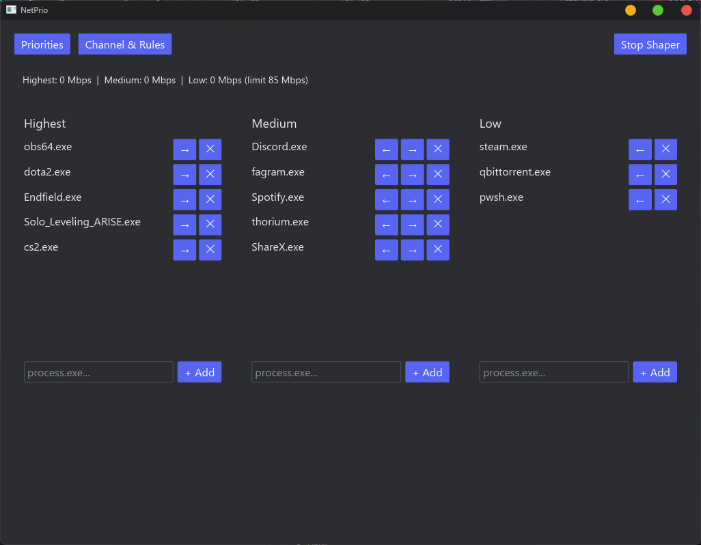
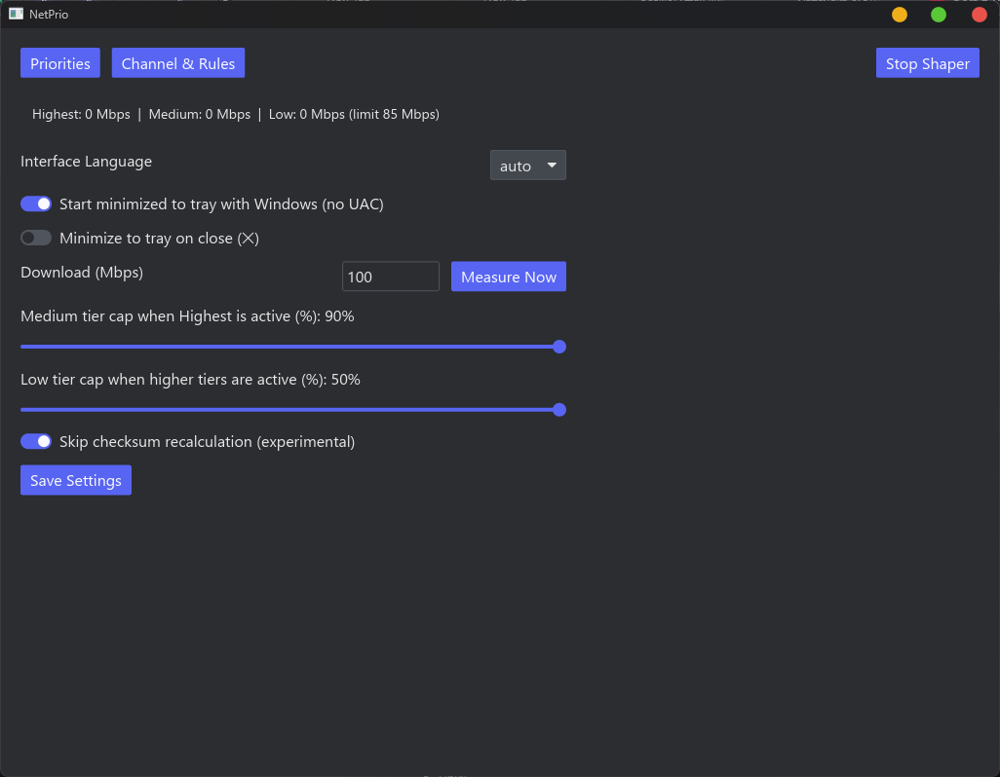

# NetPrio

A lightweight **Windows 11** utility written in **Rust** (**Iced** + `tiny-skia` software renderer) for dynamic per-application network prioritization powered by **WinDivert** — works without a QoS-capable router and alongside TUN-based VPNs.

## Screenshots

### Priorities


### Channel & Rules


## Features
- **3 Priority Tiers (`Highest` / `Medium` / `Low`)**: Move `.exe` processes between tiers or add them directly from the UI.
- **Adaptive Shaping (Fast Attack / Slow Release)**: Lock-free O(1) port-tier tables, `WinDivertRecvEx`/`WinDivertSendEx` 64-packet batching, and automatic `SNIFF` / `SHAPE` mode switching throttle background downloads (e.g., Steam, qBittorrent) only when high-priority apps are active.
- **Local Proxy & VPN Friendly**: Includes a dedicated `WINDIVERT_FLAG_SNIFF` loopback monitor for apps routed through local SOCKS5/HTTP proxies (`127.0.0.1`).
- **Single Standalone Executable**: `WinDivert.dll` and `WinDivert64.sys` are embedded at build time and extracted on demand to `%LOCALAPPDATA%\NetPrio\driver\`.
- **System Tray, Auto-Start & Bilingual UI**: Configurable minimize-to-tray on close (`✕`), elevated auto-start via Task Scheduler, memory trimming (`SetProcessWorkingSetSizeEx`), and automatic/manual **English** and **Russian** UI switching.

## Requirements
- **Windows 11 (x64)** with Administrator privileges (required by WinDivert).
- Zero runtime dependencies (no .NET or external runtimes required).

## Build from CLI
```powershell
# Place WinDivert.dll and WinDivert64.sys in the project root to embed them
cargo build --release
cargo run --release
```

Configuration is stored in `%APPDATA%\NetPrio\config.json`.
