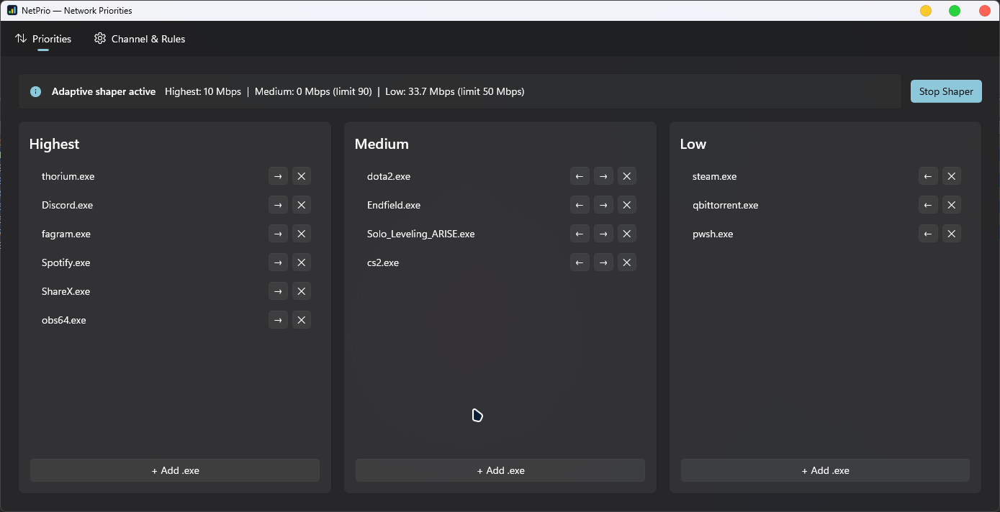
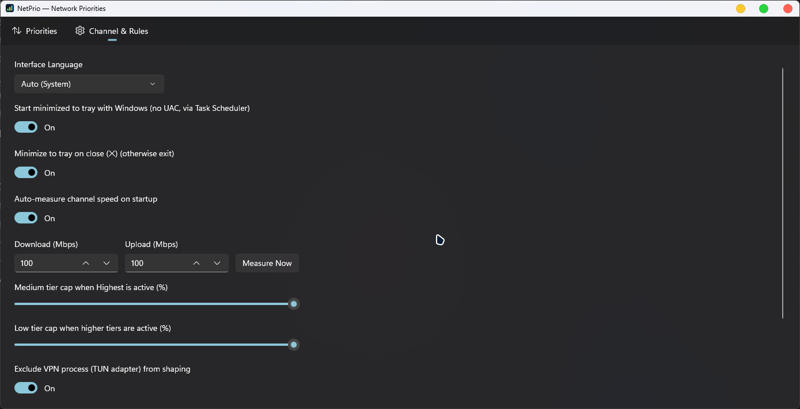

# NetPrio

A lightweight **Windows 11** **WinUI 3** utility for dynamic per-application network prioritization powered by **WinDivert** — works even without a QoS-capable router and alongside TUN-based VPNs.

## Screenshots

### Priorities


### Channel & Rules


## Features
- **3 Priority Tiers (`Highest` / `Medium` / `Low`)**: Move `.exe` processes between tiers or pick from running processes.
- **Adaptive Shaping (Fast Attack / Slow Release)**: Batch packet processing via `WinDivertRecvEx`/`WinDivertSendEx` throttles background downloads (e.g., Steam, torrents) only when high-priority apps are actively using the network, then smoothly restores bandwidth.
- **Local Proxy & VPN Friendly**: Includes a non-blocking `WINDIVERT_FLAG_SNIFF` loopback monitor for apps routed through local SOCKS5/HTTP proxies (`127.0.0.1`).
- **System Tray, Auto-Start & Bilingual UI**: Configurable minimize-to-tray on close (`✕`), elevated auto-start via Task Scheduler, and automatic/manual **English** and **Russian** UI switching.

## Requirements
- **Windows 11 (x64)** strictly (build 22000 or later) with Administrator privileges.
- **.NET 10 Desktop Runtime (x64)** — required only for the standard `NetPrio-*-win-x64.zip` build (not needed for the `-self-contained.zip` build).
- **WinDivert 2.2.2 (x64)** (`WinDivert.dll` and `WinDivert64.sys` are bundled in the repository and release archives; WinDivert is licensed under LGPLv3).

## Build from CLI
```powershell
dotnet build -c Release -p:Platform=x64
dotnet run -c Release -p:Platform=x64
```

Configuration is stored in `%APPDATA%\NetPrio\config.json`.
